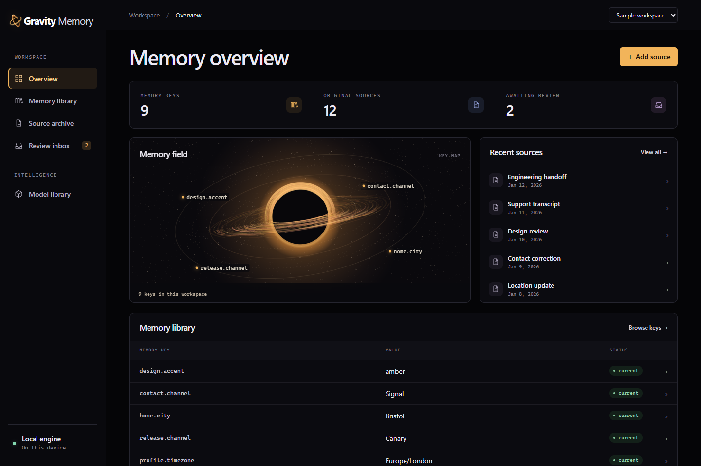

# Gravity Memory

A local memory workspace for agents that need to answer **what is current, when did it change, and who said so?** It stores an original document, cited facts and search indexes in one SQLite transaction. An accepted write is readable immediately. Python 3.11+ with SQLite FTS5 runs the core offline. Optional local models can suggest facts or retrieve semantically related passages.

## Open the workspace

On Windows x64, double-click **dist/GravityMemory.exe**. It opens the studio in the default browser and stores personal records in `%LOCALAPPDATA%\GravityMemory\workspace.sqlite`. Keep its console open while using the studio. The executable includes Python, SQLite and the optional semantic-search libraries. Actual model weights install on demand. From a source checkout use the following command with Python 3.11 or newer.

```powershell
python -m gravity_memory --db .ledger/workspace.sqlite studio
```

A fresh studio opens an isolated sample. Open **contact.channel**, follow its citation and inspect the earlier value. Choose **My workspace** before adding sources you want to keep. The source form accepts an effective date for older conversations. Review inbox lets an operator confirm a quoted fact or dismiss the source. The library, archive and timeline use the same engine exposed to agents over HTTP or MCP.



## Local model library

Core writes, corrections, current-fact reads and full-text search run offline with zero models. Under **Model library**, install Qwen 2.5 or SmolLM2 for suggested facts, or MiniLM for archive retrieval. The catalog displays size, license, runtime and upstream model card. Review routing tries only installed reviewers. It can recover from a timeout, capacity failure or an unsupported quote. An operator confirms each model-proposed fact. A valid empty extraction ends the attempt. A pending source stays readable.

Install MiniLM and choose **Index sources** in the intended workspace. In **Source archive**, select **Automatic retrieval**. It reports the route it used. New passages are immediately visible to full text. Run indexing again to add them to the semantic index. Automatic search uses a matching encoder revision and falls back to full text when needed.

For offline transfer, export a model pack and import it from the model library on the destination computer. A review pack can include its pinned Windows x64 runtime. Packs carry catalog assets, attribution and license. To move workspace records, use `export` and `restore`. Model cache and routing preferences are per OS user and shared across that user's workspaces. Override the cache directory with `GRAVITY_MODEL_DIR`.

```powershell
python -m pip install ".[semantic]"
python -m gravity_memory models list
python -m gravity_memory models install qwen-small
python -m gravity_memory models install smol-backup
python -m gravity_memory models prefer qwen-small
python -m gravity_memory models pack smol-backup reviewer.gmpack --with-runtime
python -m gravity_memory models unpack reviewer.gmpack
python -m gravity_memory models install minilm
python -m gravity_memory --db .ledger/workspace.sqlite --model minilm index-vectors
python -m gravity_memory --db .ledger/workspace.sqlite search "customer escalation" --view auto_archive
```

The Windows executable includes the semantic extra. Other Python installations can install it from the source checkout. Review uses the cached Windows CPU runtime, or an existing `llama-server` on PATH or at `GRAVITY_LLAMA_SERVER`. Linux and macOS users supply their local server binary. The application launches it on loopback for one request, then stops it. Initial installation accesses the upstream host for model files. Local inference uses the workstation. You can also select an existing Ollama model explicitly through the CLI. [Model catalog](gravity_memory/catalog.json) · [Source and model design decisions](FIELDNOTES.md)

## Results

On the internal correction replay, the default engine ranked the correct value first on 12/18 answerable questions, exposed an obsolete value on 0/11 correction probes and returned empty on 9/9 unknowns. On 120 public LoCoMo questions, hybrid and full-text retrieval found at least one gold turn in 76 and 73 cases respectively. Both recovered every gold turn in 58 cases. These are retrieval measurements. General superiority over vendor products and willingness to pay remain untested. [Research and test findings](FIELDNOTES.md) · [Competitor code and customer discovery](RESEARCH.md) · [Storage measurements](evals/gravity-scale-results.json)

## Try a correction

Run from the project directory. The demo uses a temporary database and cleans up afterwards.

```powershell
python -m gravity_memory demo
```

The demo writes a move from Seattle to Tucson, then imports an older Reno conversation. The current lookup returns Tucson, January's lookup returns Seattle, and a repeated write returns its original receipt. The standalone distribution also runs with `python dist/gravity-memory.pyz demo` and can be copied to another machine with Python and SQLite FTS5. From a source checkout, rebuild the portable application and source ZIP with `python scripts/package.py`.

For a persistent workspace, give each customer or project its own database. From a trusted app, select the database using the authenticated user's identity. Two agent processes launched with the same file can share that history.

```powershell
python -m gravity_memory --db .ledger/demo.sqlite add --id turn-1 --source chat/1 --role user --text "I live in Seattle." --at 2026-01-01T00:00:00Z
python -m gravity_memory --db .ledger/demo.sqlite add --id turn-2 --source chat/2 --role user --text "I moved to Tucson." --at 2026-02-01T00:00:00Z
python -m gravity_memory --db .ledger/demo.sqlite lookup home.city
python -m gravity_memory --db .ledger/demo.sqlite lookup home.city --at 2026-01-15T00:00:00Z
python -m gravity_memory --db .ledger/demo.sqlite history home.city
python -m gravity_memory --db .ledger/demo.sqlite search "Seattle" --view archive
```

## Application writes

```python
from gravity_memory import Ledger

memory = Ledger(".ledger/account-821.sqlite")
receipt = memory.remember(
    request_id="ticket-104/change-2",
    source="support/ticket-104",
    text="For after-hours incidents please page Kim.",
    effective_at="2026-04-01T09:00:00-07:00",
    facts=[{
        "key": "support.after_hours.primary",
        "value": "Kim",
        "quote": "after-hours incidents please page Kim",
    }],
)
answer = memory.lookup("support.after_hours.primary")
proof = answer["evidence"][0]
original = memory.source(proof["request_id"])["text"]
assert original[proof["start"]:proof["stop"]] == proof["quote"]
```

Use a stable request ID from the calling system. An identical retry returns the previous acknowledgment. Different input under an existing ID raises `Conflict` and maps to HTTP 409. A second independent source with identical text can still contribute evidence. Supplied quotes and values must occur verbatim in the original. The caller can specify a zero-based Unicode code-point offset with the fact's `start` field to disambiguate repeated passages.

Choose single-valued field names. Two concurrent roles can use distinct keys such as `support.primary` and `support.backup`. The application owns the subject and field vocabulary. Two names for the same field create two timelines. Exact aliases, entity resolution across arbitrary documents, and the truth of a quoted statement need application or reviewer judgment.

| Read or write | Behavior |
|---|---|
| `remember(..., role="document")` | Archives the full text with overlapping, indexed passages. Supplied facts become part of the profile. Default role for imports and attachments. |
| `remember(..., role="user")` | With facts omitted, a small English parser recognizes declarations about name, home city, employer, timezone and contact channel. An explicit list selects the caller's facts. An empty list archives without inference. |
| `remember(..., role="assistant")` | Archives assistant output. The assistant's own guesses have no automatic route into the profile from that turn. Source roles are assertions by the trusted caller. |
| `lookup(key, as_of=..., known_at=...)` | Picks the latest effective revision known by the requested recording time. Returns current, unknown, expired, revoked or disputed, plus evidence where available. A newer expired or revoked revision suppresses older values. Differing assertions for the same effective instant produce a dispute. |
| `lookup(..., require_review=True)` | May return pending_review and the IDs of at most three newer eligible unclassified user turns. The check is workspace-wide and can hold unrelated facts. Partially parsed turns and off-topic matches still require application judgment. |
| `search(query)` | Ranks lexical matches over current fact keys and values. Returns the matched source, BM25 rank and query terms. Free-text questions can retrieve the wrong subject. Use a canonical key for a field the application knows. |
| `search(query, view="archive")` | Returns matching original passages with source offsets. Superseded and expired claims can be present in historical material. |
| Revocation | Write a new cited fact with the same key and `value: null`. Its history remains auditable. A fact can also carry an `expires_at` timestamp. Expiry is exclusive. |
| `erase()` | Removes originals, annotations, versions, receipts, index entries and vectors for this database from application access. Exports, backups and physical media have their own retention lifecycle. |

## Review an extraction miss

An original can be searchable before an operator knows which facts to promote. This example handles a sentence outside the default grammar.

```powershell
python -m gravity_memory --db .ledger/demo.sqlite add --id turn-3 --source chat/3 --role user --text "These days I call Ghent home."
python -m gravity_memory --db .ledger/demo.sqlite pending
python -m gravity_memory --db .ledger/demo.sqlite lookup home.city --require-review
python -m gravity_memory --db .ledger/demo.sqlite annotate turn-3 --id review-3 --key home.city --value Ghent --quote "I call Ghent home"
python -m gravity_memory --db .ledger/demo.sqlite lookup home.city
```

The annotation references turn-3, adopts its effective time and records when the review happened. An earlier knowledge-time query still reconstructs what the service could return before the review. Use `annotate turn-3 --id review-3 --dismiss` for a previously unreviewed turn with no relevant claims. For several facts in one review, use `call annotate` with a JSON array under `facts`. To resolve an actual same-time disagreement, submit a new authoritative source with a later effective time. The pending list covers originals that produced zero facts. A partly extracted multi-fact source can be reviewed directly by ID.

For optional model-assisted review, create `fields.json` with definitions such as `{"home.city":"Current primary home city of the account holder"}`. With a locally installed Ollama chat model, run `python -m gravity_memory --db .ledger/demo.sqlite suggest turn-3 --fields fields.json --chat-model YOUR_MODEL`. The output is a proposal. The program checks allowed fields and source spans, and an operator or trusted application issues the annotation. Each invocation sends one source to the loopback Ollama service. [Ollama structured output API](https://docs.ollama.com/capabilities/structured-outputs)

## Use from other tools

**MCP over stdio.** Point an MCP client at Python and the portable application. This example uses absolute Windows paths. Change the database path to bind the tool server to the intended workspace. It advertises remember, lookup, search, history, source, pending, annotate and status. Use separate server configurations for separate customers.

```json
{
  "mcpServers": {
    "gravity-memory": {
      "command": "python",
      "args": ["C:/Users/sachc/Projects/gravity-memory/dist/gravity-memory.pyz",
               "--db", "C:/Users/sachc/Projects/gravity-memory/.ledger/demo.sqlite", "mcp"]
    }
  }
}
```

**Local HTTP.** Run these commands in the project directory. Set `GRAVITY_TOKEN` in the client environment to the same value as the server. The built-in server binds to 127.0.0.1 and the selected database. It is a local integration endpoint. Network hosting, tenant authentication, TLS, rate limits and replication belong in a deployment layer.

```powershell
$env:GRAVITY_TOKEN = python -c "import secrets; print(secrets.token_urlsafe(32))"
python -m gravity_memory --db .ledger/demo.sqlite serve --port 8765
```

```powershell
Invoke-RestMethod -Method Post -Uri http://127.0.0.1:8765/v1/lookup -Headers @{Authorization = "Bearer $env:GRAVITY_TOKEN"} -ContentType application/json -Body '{"key":"home.city"}'
```

Each named MCP operation also accepts a JSON object at `POST /v1/<operation>`, or from the CLI as `call <operation> --file request.json`. A client cannot override the server's database in its payload. The CLI and Python library also expose local administrative operations. Store the database in an OS-protected directory. The SQLite file contains plaintext evidence.

## Import and export

```powershell
python -m gravity_memory --db .ledger/account.sqlite import-provider mem0 mem0-page.json --scope user-821
python -m gravity_memory --db .ledger/account.sqlite import-provider supermemory supermemory-page.json --scope user-821
python -m gravity_memory --db .ledger/account.sqlite pending --role document
python -m gravity_memory --db .ledger/account.sqlite export --file account.jsonl
python -m gravity_memory --db .ledger/restored.sqlite restore account.jsonl
```

Mem0 inputs can be an array or a results page containing id, user_id, memory and an offset-aware updated_at or created_at. Supermemory inputs can be an array or a documents page with id, containerTags or containerTag, **full content**, and updatedAt or createdAt. Fetch document detail if a list export contains summaries only. The importer uses the upstream revision timestamp as the source effective time. Scope-mismatched rows are counted and skipped. In-scope malformed rows fail the page atomically. Replaying the same page is safe. Upstream IDs remain visible under source. Mem0 extraction output is preserved as a provider assertion. Importing cannot reconstruct a missing upstream transcript.

The native JSONL snapshot preserves source text, write IDs, review operations, effective dates, recording dates and the exact extracted assertions. The footer carries a record count and SHA-256 digest so restore can detect truncated or changed snapshots. Restore runs in one transaction into an empty workspace. Optional model vectors are rebuildable and excluded. The CLI export creates a new destination. Workspace erasure requires the absolute path again via `--confirm` and is available only locally. Historical expiry or revocation alone retains the source.

## Optional semantic passage search

With a local Ollama embedding model already available, index passages and query the resulting archive.

```powershell
python -m gravity_memory --db .ledger/demo.sqlite --model embeddinggemma index-vectors
python -m gravity_memory --db .ledger/demo.sqlite --model embeddinggemma search "relocation" --view hybrid_archive
```

The indexer discovers missing vectors from committed sources, validates each batch and can resume after a failure. New passages are immediately searchable via full text. Hybrid search combines lexical and cosine ranks using reciprocal rank fusion and reports the fraction of eligible passages indexed. Use an immutable model tag for consistent vector space. The dense path scans eligible vectors locally and is intended for modest corpora. Model quality depends on the installed model. [Ollama embedding API](https://docs.ollama.com/api/embed)

## Reproduce the evidence

```powershell
python -m unittest discover -s tests -v
python -m evals.run --out evals/gravity-results.json
python -m evals.scale --out evals/gravity-scale-results.json
python -m evals.local_models --out evals/model-results.json
python -m evals.locomo PATH_TO_PINNED_LOCOMO10_JSON --out evals/locomo-results.json
```

The model replay requires all three catalog models and the review runtime. The LoCoMo replay requires the pinned dataset and MiniLM with its semantic dependencies. For the browser journey, install Playwright and its Chromium binary, then run `node tests/browser.cjs`. Optional environment variables `GRAVITY_TEST_PACK`, `GRAVITY_APP` and `GRAVITY_EXE` exercise a real MiniLM pack, a zipapp or a standalone executable. `GRAVITY_SCREENSHOTS` selects the output directory. Rebuild the Windows executable in an isolated Windows x64 environment containing PyInstaller, numpy, onnxruntime and tokenizers with `python scripts/package_windows.py`.

The free-text replay gives every engine the same raw user messages in the same order. The local baseline uses SQLite BM25 over the transcripts. The fact and review-gated modes use Gravity Memory's offline parser and get no gold fields. The separate scale test supplies structured facts to isolate storage correctness. Both persist machine-readable results, including per-query text for the retrieval replay.

For a live comparison, use a disposable deployment and set `RECALL_BENCH_TOKEN` if its API requires authentication. The runner writes synthetic scopes with a unique prefix and leaves them available for inspection. Record the actual server version and model configuration with `--version`. Mem0 uses its OSS REST surface. Supermemory uses document ingestion, waits for indexing, then queries memory entries. The runner stops on transport or ingestion failures. A failed setup has no retrieval score.

```powershell
python -m evals.run --engine mem0-oss --url http://127.0.0.1:8888 --version "YOUR_VERSION_AND_MODELS" --out mem0-results.json
python -m evals.run --engine supermemory --url http://127.0.0.1:3000 --version "YOUR_VERSION_AND_MODELS" --out supermemory-results.json
```

These adapter contracts were checked with response fixtures. Published vendor benchmark scores use different datasets and evaluators. This repository's own measurements cover its local engine and transcript baseline. See the [research report](RESEARCH.md) for the measured failure cases, limits and proposed paid pilot.
